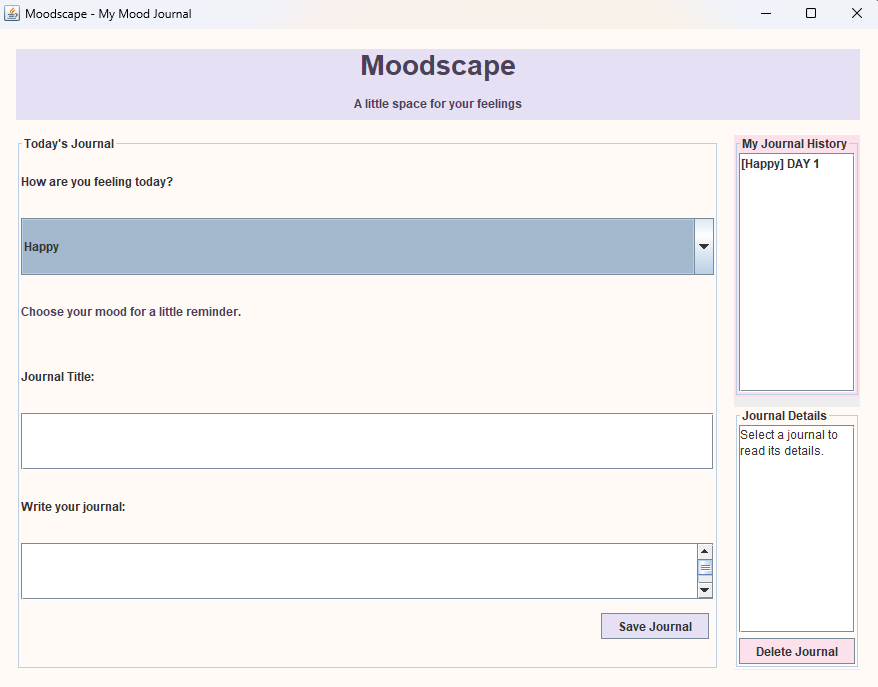
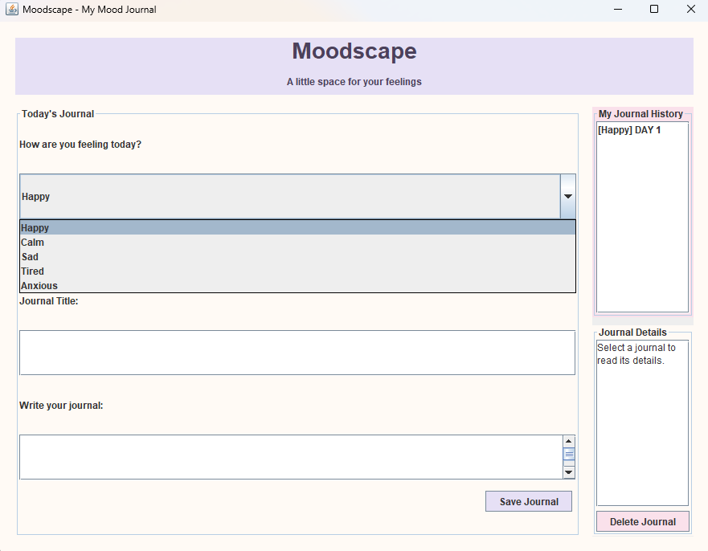
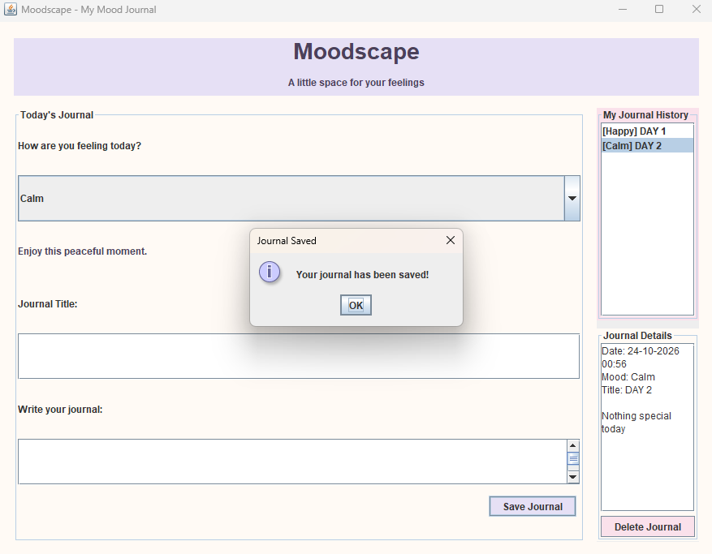
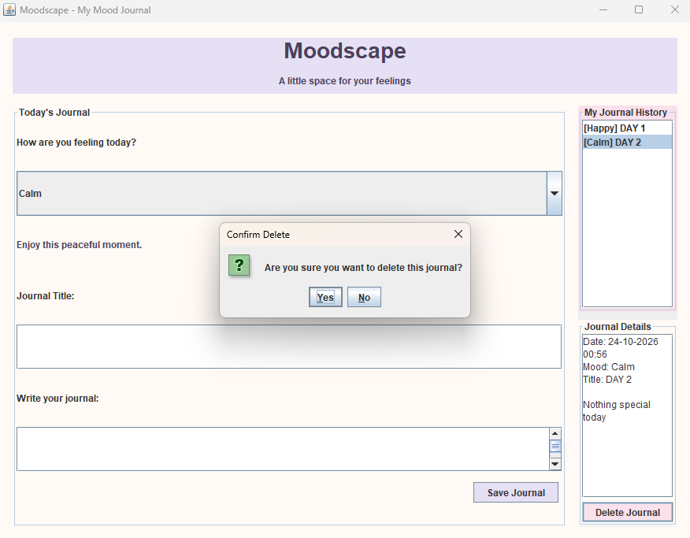

# Moodscape — My Mood Journal

# Moodscap by:
- Nama: Ade Ratu Safitri
- NIM: F1D02410033

## Deskripsi
Moodscape adalah aplikasi desktop berbasis Java Swing yang memungkinkan pengguna menulis jurnal harian berdasarkan suasana hati (*mood*). Aplikasi ini memiliki tampilan bernuansa pastel dan dapat menyimpan data jurnal ke dalam file sehingga riwayat tetap tersedia saat aplikasi dibuka kembali.

## Fitur
- Memilih mood: Happy, Calm, Sad, Tired, atau Anxious.
- Menulis jurnal dengan judul dan isi.
- Menampilkan pesan sesuai mood yang dipilih.
- Melihat riwayat dan detail jurnal.
- Menghapus jurnal dengan konfirmasi.

## Komponen GUI

| Komponen | Implementasi | Kegunaan dalam Moodscape |
|---|---|---|
| Top-Level Container | `JFrame` | Menjadi jendela utama aplikasi Moodscape. |
| Intermediate Components | `JPanel`, `JScrollPane` | Mengelompokkan komponen dan menyediakan area yang bisa di-scroll. |
| Atomic Components | `JLabel`, `JTextField`, `JTextArea`, `JComboBox`, `JButton`, `JList` | Menampilkan teks, menerima input jurnal, memilih mood, menjalankan aksi, dan menampilkan riwayat jurnal. |
| Layout Manager | `BorderLayout`, `GridLayout`, `FlowLayout` | Mengatur posisi dan susunan komponen pada tampilan aplikasi. |
| Event Handling | `ActionListener`, `ListSelectionListener` | Menangani klik tombol dan pemilihan jurnal pada riwayat. |

## Screenshot
- Tampilan Utama
    
- Pemilihan Mood
    
- Jurnal Tersimpan
    
- Konfirmasi Hapus
    